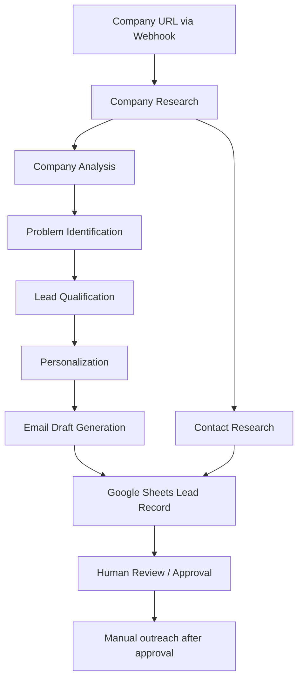

# AI SDR & Lead Research Agent

An AI-powered B2B/SaaS sales research workflow that researches a company, identifies potential business opportunities, qualifies the lead, prepares a personalized outreach email draft, and records the research in Google Sheets.

> **Project:** AI Real-World Use Case Lab — Project 1  
> **Domain:** B2B / SaaS  
> **Workflow status:** Exported workflow is currently disabled/paused. Review configuration and test before running.

## Business Problem

Sales development teams can spend substantial time researching companies, identifying possible pain points, assessing prospect fit, finding public business contact details, and writing relevant outreach. This workflow aims to organize those activities into a repeatable AI-assisted process.

The system should treat company-specific facts separately from reasonable observations. It must not invent internal company information or guess email addresses.

## Goals

- Research a company from its website URL.
- Create a structured company profile.
- Analyze business activities and potential AI/SaaS opportunities.
- Identify and prioritize a potential business pain point.
- Score lead fit using a transparent 100-point model.
- Develop a company-specific personalization strategy.
- Generate an email **draft only**.
- Search for publicly listed business contact information without guessing.
- Save lead research and draft details to Google Sheets.
- Keep outreach subject to human review and approval.

## Workflow Overview



The diagram summarizes the intended process. Confirm the exact connections and field mappings in the workflow platform before relying on it.

## Workflow Stages

1. **Webhook input** — accepts the company website URL (`company_url`).
2. **Company Research** — gathers public company information and returns structured JSON such as industry, products/services, target customers, business model, operations, potential challenges, and AI/automation opportunities.
3. **Company Analysis** — analyzes business activities, repetitive processes, possible problems, and potential value opportunities.
4. **Problem Identification** — describes candidate pain points, supporting evidence, business impact, and confidence; selects one primary pain point.
5. **Lead Qualification** — scores business relevance, problem relevance, potential business value, and AI/SaaS opportunity (25 points each; 100 points total).
6. **Personalization** — creates a company-specific opening observation, problem hypothesis, solution connection, value proposition, reason for contact, and one low-friction call to action.
7. **Email Generator** — prepares a concise email subject and body. The prompt explicitly says not to send the email.
8. **Contact Research** — checks the company's public website for relevant business contact information. It must not guess email addresses; unknown information should be returned as `null`.
9. **Google Sheets** — adds a row containing company, research, qualification, personalization, email draft, approval/sending status, and contact details.

## Lead Qualification Scoring

| Criterion | Maximum points |
|---|---:|
| Business relevance | 25 |
| Problem relevance | 25 |
| Potential business value | 25 |
| AI/SaaS opportunity | 25 |
| **Total** | **100** |

Qualification bands in the workflow:
- **80–100:** Strong Fit
- **60–79:** Moderate Fit
- **0–59:** Low Fit

Scores should be evidence-based and should not be inflated to make a prospect appear more suitable.

## Technology and Integrations

Based on the supplied workflow export:
- Webhook trigger for the company URL
- AI completion steps for research, analysis, pain-point identification, qualification, personalization, email drafting, and contact research
- Google Sheets integration for lead storage

The export does not establish that the workflow is currently operational. Review provider/model settings, credentials, field mappings, and connections in the workflow platform.

## Repository Structure

```text
ai-sdr-lead-research-agent/
├── README.md
├── workflow/
│   └── ai_sdr_lead_research_agent.json
└── docs/
    └── workflow-documentation.md
```

## Setup and Use

1. Import `workflow/ai_sdr_lead_research_agent.json` into a compatible automation platform.
2. Configure the required AI/model provider and Google Sheets connection.
3. Verify the target spreadsheet and worksheet, including the expected column mapping.
4. Confirm that the webhook expects `company_url`.
5. Test using a company website with public information.
6. Check the structured output at each AI step and confirm downstream field mappings.
7. Review the final Google Sheets row for completeness and correctness.
8. Keep the workflow disabled until configuration and tests are satisfactory.
9. Require a human to review the lead and email draft before any outreach is sent.

Do not commit API keys, OAuth tokens, passwords, or other credentials. Before publishing publicly, review the exported JSON for account-specific identifiers and spreadsheet IDs, and replace or remove sensitive configuration where appropriate. Re-import and test any edited export because redaction can affect compatibility.

## Testing Checklist

- [ ] Valid company website produces a structured company profile.
- [ ] Limited or unavailable website results in missing evidence being acknowledged, not invented.
- [ ] No public contact email results in `null`; no email is guessed.
- [ ] Weak prospect fit receives a reasoned score.
- [ ] Invalid or incomplete URL is handled clearly.
- [ ] Google Sheets write failures are surfaced.
- [ ] Email remains a draft until a human approves it.

These are proposed tests; do not mark them passed until they have actually been run.

## Limitations and Safety

- Public website research may be incomplete or outdated.
- Potential pain points and AI opportunities are hypotheses unless supported by evidence.
- AI-generated summaries, scores, and drafts require human review.
- Email generation is not email sending; outreach must remain behind human approval.
- The supplied export is disabled/paused and contains steps flagged with automatic issues. Resolve these and test the end-to-end flow before presenting it as operational.
- Use public business information responsibly and comply with applicable privacy, anti-spam, and website terms.

## License

No license has been specified. Add a license only after deciding the terms under which this project may be reused.
