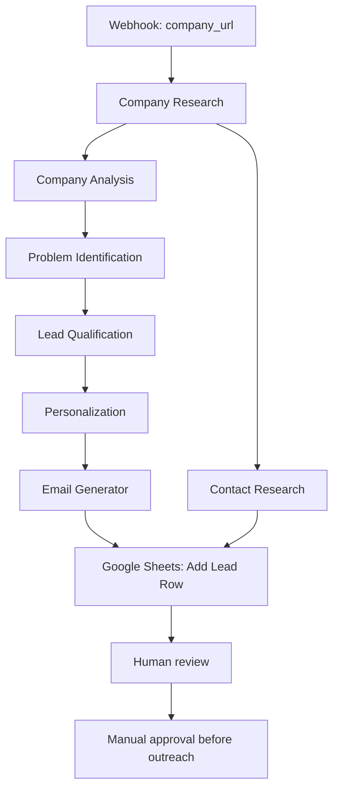

# Workflow Documentation: AI SDR & Lead Research Agent

## 1. Purpose

This document describes the supplied `ai_sdr_lead_research_agent` workflow export for the B2B/SaaS AI SDR / Lead Research Agent project.

The workflow is intended to reduce repetitive sales research while preserving evidence-based decisions and human review. It researches a company, analyzes possible opportunities, qualifies the lead, drafts personalized outreach, researches publicly listed contact information, and writes a lead record to Google Sheets.

## 2. Input and Output

### Input

- `company_url`: the target company's website URL supplied to the webhook trigger.

### Expected outputs

The AI steps return structured fields including:

- Company name, website, industry, description, products/services, target customers, business model, geographic focus, company size, operations, and research observations.
- Potential business problems, supporting evidence, primary pain point, and reasoning.
- Four lead-fit scores, total score, qualification label, and qualification reason.
- Personalization strategy and call to action.
- Email subject, email body, and CTA.
- Public contact name, role, email, and source URL (nullable when not found).
- A Google Sheets row containing selected research and outreach fields.

The workflow export is the source of the field names. Check the platform's actual output mappings when importing or editing the workflow.

## 3. Components

### 3.1 Webhook trigger

Receives the company website URL. Validate that the URL is present and points to the intended company before starting research.

### 3.2 Company Research

Builds a structured profile from the company's public website and other publicly available company information. The prompt explicitly prohibits inventing facts, creating a sales pitch, or writing an email at this stage.

### 3.3 Company Analysis

Uses the research profile to examine core business activities, customer-facing activities, repetitive/manual processes, information-heavy processes, possible business problems, and AI/automation opportunities. It selects the strongest potential opportunity for further analysis.

### 3.4 Problem Identification

Identifies candidate pain points, explains why each may matter, records evidence/reasoning and potential impact, and labels confidence. It selects one primary pain point. Inferences must not be presented as confirmed internal facts.

### 3.5 Lead Qualification

Scores the prospect across four dimensions:

| Dimension | Maximum |
|---|---:|
| Business relevance | 25 |
| Problem relevance | 25 |
| Potential business value | 25 |
| AI/SaaS opportunity | 25 |
| **Total** | **100** |

Classification:
- 80–100: Strong Fit
- 60–79: Moderate Fit
- 0–59: Low Fit

The score should reflect available evidence and include a reason.

### 3.6 Personalization

Produces an opening observation, problem hypothesis, why the issue may matter, solution connection, value proposition, reason for contact, and one low-friction CTA. It must avoid generic compliments, exaggeration, and unsupported claims.

### 3.7 Email Generator

Generates a concise email subject and body using the research, primary pain point, qualification, and personalization. Its instructions explicitly prohibit sending the email and require a draft only.

### 3.8 Contact Research

Checks public pages on the company's official website, such as Contact, About, Team, Leadership, Sales, Business Development, and Operations. It prefers relevant business contacts but must not guess email addresses or assume email patterns. If no public email is found, the email should be `null`.

### 3.9 Google Sheets storage

Adds a row to the configured spreadsheet. The export maps company details, research fields, primary pain point, qualification score/label, personalization observation, email subject/body, approval/sending status, and contact email.

The export contains a spreadsheet identifier and account/workflow metadata. Verify that the destination spreadsheet is intended for this project and that it is safe to share the export publicly.

## 4. Intended End-to-End Flow

This is a conceptual representation of the stages in the export. Validate the actual platform connections and mapping after import.

## 5. Human-in-the-Loop Controls

- The generated email is a draft, not an automatically sent message.
- A human should verify facts, pain-point evidence, fit score, contact source, and email wording.
- Only proceed with outreach after explicit human approval.
- If the workflow is extended later to send email automatically, retain an approval gate and log the approving person/time.

## 6. Configuration and Import Checklist

1. Import the JSON into the compatible automation platform.
2. Confirm the webhook endpoint and the input key `company_url`.
3. Configure the AI/model provider for every completion step.
4. Configure the Google Sheets connection and verify the spreadsheet and worksheet.
5. Confirm that all input mappings reference the correct preceding outputs.
6. Check any steps flagged with automatic issues in the export.
7. Verify that the workflow's disabled/paused state is intentional; do not enable it until testing is complete.
8. Run test inputs and inspect each step's output.
9. Verify the final spreadsheet row and the human-review status.
10. Record any manual configuration that is required but not stored in the exported JSON.

## 7. Test Plan

| Test | Expected result | Result |
|---|---|---|
| Company website with clear public information | Structured research profile with evidence-based observations | Not yet recorded |
| Website unavailable or has very little information | Missing data is acknowledged; no facts are invented | Not yet recorded |
| No public contact email | Contact email is `null`; no guessed email | Not yet recorded |
| Company has weak evidence of a relevant opportunity | Score reflects limited evidence and gives a reason | Not yet recorded |
| Invalid/missing URL | Input is rejected or handled clearly | Not yet recorded |
| Google Sheets connection/write fails | Failure is visible; workflow does not claim the row was saved | Not yet recorded |
| Email review | Email remains a draft until human approval | Not yet recorded |

These are proposed tests, not claims that tests have already passed.

## 8. Known Status and Limitations

The supplied JSON export reports the workflow status as `off` and all listed nodes as paused. Some nodes also have automatic-issue flags. This indicates that configuration and runtime validation are still needed; the JSON alone does not prove the workflow is running end to end.

Other limitations:
- Public information can be incomplete or outdated.
- AI analysis and lead scoring can be wrong and need human review.
- Inferred pain points must be labeled as hypotheses.
- Contact details must be traceable to public sources.
- Spreadsheet and model credentials are configured in the automation platform and may not be portable with the JSON export.

## 9. Publishing and Security Notes

Before making the repository public:

- Review the workflow export for API keys, OAuth tokens, passwords, personal data, account identifiers, and internal resource IDs.
- Confirm whether the Google Sheets ID and account/workflow identifiers should be included in a public repository.
- Remove credentials from the file; configure secrets through the platform's credential manager.
- If editing or redacting the JSON, validate that the resulting export still imports correctly.
- Do not include real customer/prospect data in examples; use synthetic or publicly available sample data.
- Add a license only if you have decided how the project may be reused.
